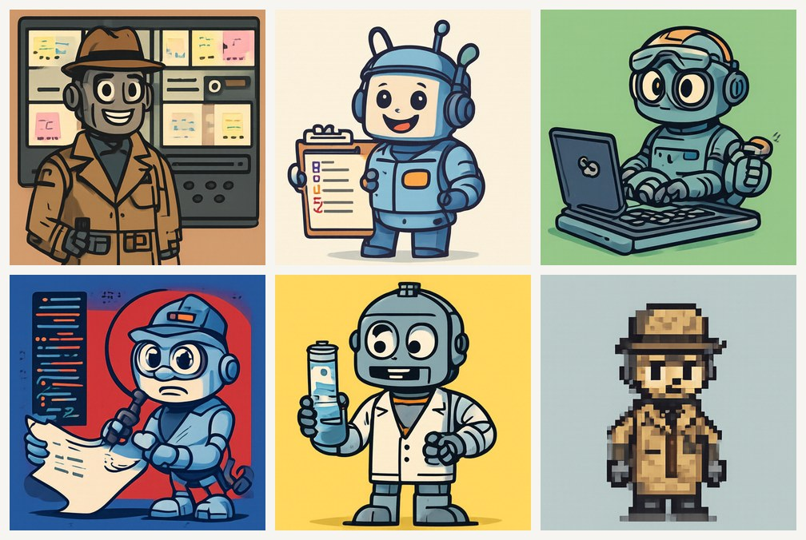

# Timon Avatar Studio

Generate avatars for your [Timon](https://timon-ai.com) agents from a text prompt, **locally on the CPU**, and apply them to an agent in one click. It adds an **Avatars** page to the side menu.



- **Prompt or preset → 512×512 image** in about 5 s on a desktop CPU. No GPU, no API key, no cloud service: the image model runs inside your Timon daemon.
- **Presets made for agent avatars**: mission commander, coder, reviewer, planner, scheduler, tester… in an 80s-cartoon style, plus chibi, 3D and pixel art. Administrators edit the list in *Settings › Plugins › Avatar Studio*.
- **A seed per image**: keep it and change the end of the prompt to get variations of the same character.
- **A gallery per account**. Hover an image to read its prompt, seed and age, reuse them, download the PNG, delete it, or **set it as an agent's avatar**.
- **"Generate an avatar"** in each agent's menu (*…* on the TIMs list) opens the page with that agent preselected.
- The interface is in English and French, following Timon's language.

> **Prompts and images stay on your machine.** The only network request the plugin ever makes is the one-time download of the model from Hugging Face, and you can skip it by copying the files yourself.

## Requirements

- Timon with plugin API **15** or later (Timon 0.1.8+): the page uses `NavLink`, `createTranslator`, `confirmAction` and the `agent.menu.item` slot.
- About **1.5 GB of free RAM** while the model is loaded, and **313 MB** of disk for the model.
- Internet access from the daemon at install time: `timon plugin add` downloads `onnxruntime-node` from npm (about 300 MB; binaries for Linux and Windows x64/arm64 and Apple Silicon Macs).
- **Developer mode**: this plugin is not signed, and Timon loads an unsigned plugin only in developer mode. Turn it on in *Settings › Plugins › Developer mode* (superadmin), or in `timon.config.json` (takes effect after a restart):

  ```json
  { "developer": { "unsignedPlugins": true } }
  ```

## Install

From the release archive:

```sh
timon plugin add ./timon-avatar-studio-0.1.0.tgz
```

Or from this repository:

```sh
git clone https://github.com/Navis-Ai-Lab/timon-avatar-studio.git
cd timon-avatar-studio
timon plugin add .
```

There is no build step: the files in `lib/` are what Timon runs. Then open **Avatars** in the side menu, or go to `/avatars`.

- Check that it is active: `timon plugin list`.
- Update: `git pull` (a linked working copy reloads by itself), or `timon plugin add` the new archive. Your galleries and the model are kept.
- Remove: `timon plugin remove avatar-studio`. Timon keeps the plugin's data folder (model and images) in case you reinstall it.

### The model (313 MB, once)

The first time, the page asks for the model. Either:

- **Click *Download the model*.** On the install sheet, tick the hosts `huggingface.co` and `*.hf.co`, or add this to `timon.config.json`:

  ```json
  { "pluginPolicy": { "http": { "byPlugin": { "avatar-studio": ["huggingface.co", "*.hf.co"] } } } }
  ```

  The download is pinned to commit `cfdc0d1` of the model repository.
- **Or copy it by hand** (offline servers): put `minit2i.onnx`, `minit2i.onnx.data` and `vocab.json` from [the model repository](https://huggingface.co/cfahlgren1/MiniT2I-B-16-MF-compact-webgpu-int8/tree/cfdc0d1ed60ac43d922b7ba8da4f365dd8579feb) in `<TIMON_HOME>/plugins-data/avatar-studio/model/`.

## Permissions

| Permission | Why |
| --- | --- |
| `storage` | The model and the generated images in the plugin's data folder; the gallery index |
| `settings` | Read the CPU thread count |
| `agents:read` | List agents in the *Set as avatar* menu |
| `agents:manage` | Set an agent's picture. Timon checks that the signed-in account may manage that agent |
| `http:outbound` (`huggingface.co`, `*.hf.co` only) | The one-time model download |

## Settings

*Settings › Plugins › Avatar Studio*

- **CPU threads**: `0` (the default) uses all cores but one, so Timon and your agents stay responsive. Lower it on a busy server. Takes effect on the next image.
- **Presets**: add, edit, remove or restore the defaults. Shared by every account.

## Writing prompts

- Write in English. The model understands it much better.
- Short visual descriptions work best: who, what they hold, expression, style, background.
- For a consistent team, keep the same ending (`80s cartoon style, bold outlines, flat colors, centered portrait`) and change only the role and the background colour.

## How it works

| | |
| --- | --- |
| Model | [MiniT2I-B-16-MF-compact](https://huggingface.co/lox9973/MiniT2I-B-16-MF-compact): MiniT2I by Wang, Zhao, Lu, Zhou, Ma and He, compact version by lox9973, int8 ONNX export by [cfahlgren1](https://huggingface.co/cfahlgren1/MiniT2I-B-16-MF-compact-webgpu-int8). 4 steps, 512×512, T5 text encoder |
| Runtime | `onnxruntime-node` inside the daemon, CPU only |
| Speed | About 5 s per image on a recent desktop CPU, 20–60 s on a small server (i3, 2-vCPU VPS), plus about 10 s to load the model the first time |
| Queue | One image at a time, at most 4 waiting. The model is unloaded after 10 minutes without use |
| Storage | `<TIMON_HOME>/plugins-data/avatar-studio/`: `model/` (shared) and `images/<account>/` (about 450 KB per PNG, the last 200 kept per account) |

## Development

```sh
npm install --ignore-scripts   # onnxruntime-node, for the tests and a local run
npm test                       # tokenizer, noise, PNG encoder, routes, per-account galleries, migration
timon plugin check .           # Timon's pre-ship check
timon plugin add .             # install your working copy; host files reload on save
```

| Path | What it is |
| --- | --- |
| `lib/index.js` | Host half: the routes (`/status`, `/download`, `/generate`, `/images`, `/agents`…), the generation queue, the model download, the PNG encoder |
| `lib/tokenizer.js` | T5 tokenizer and the seeded initial noise: pure, tested |
| `lib/client.js` | Browser half: the page, the side-menu entry, the agent menu entry, the settings pane and the English and French texts. Plain ESM; React and `@timon/ui` come from Timon |
| `test/` | `node --test` suite. It needs neither the model nor Timon |
| `assets/` | Cover and screenshot shown in Timon's plugin gallery |

## Known limits

- Images are 512×512: the model was trained at that size.
- It is a small, fast model. It does well on cartoon and illustration styles, less well on photorealistic faces, and it cannot write text: names in a prompt will not be legible.
- onnxruntime's graph optimisations are turned off on purpose, because its layer-norm fusion pass fails on this export.
- Generation shares the daemon's CPU. On a small server, lower *CPU threads* if your agents slow down while an image is generated.

## Licence

[MIT](LICENSE). MiniT2I and its compact and ONNX versions are MIT too ([LICENSE-MiniT2I.txt](LICENSE-MiniT2I.txt)). The text encoder is initialised from Google's FLAN-T5 (Apache-2.0). The licences cover the code and the weights and come with no warranty: you are responsible for how you use the generated images.
